# Microsoft 365 Administration & Identity Management Lab

## Project Overview
This project demonstrates administration of a Microsoft 365 environment using Microsoft Entra ID and the Microsoft 365 Admin Center. This lab was designed to simulate common Help Desk and IT Support responsibilities including user creation, password management, and audit log review. 

# Environment Setup
- **Microsoft 365 Business Premium Trial**
- **Microsoft 365 Admin Center**
- **Microsoft Entra ID**
- **Test Accounts**
  - Sophia S
  - Virgil C
  - Joaquin G
    
 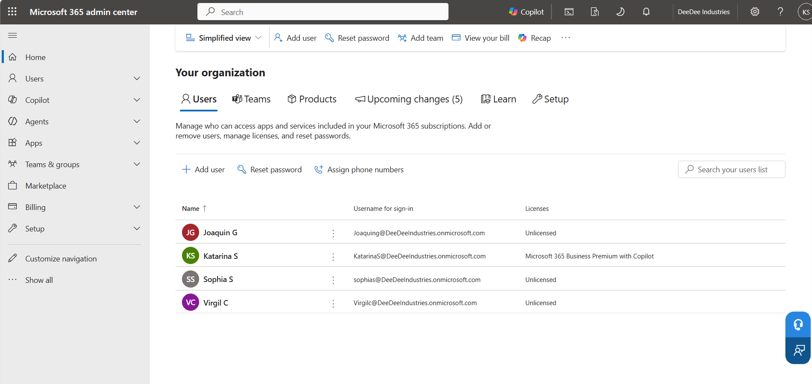
# User Administration
## User Creation

**Created and managed user accounts through the Microsoft 365 Admin Center.**

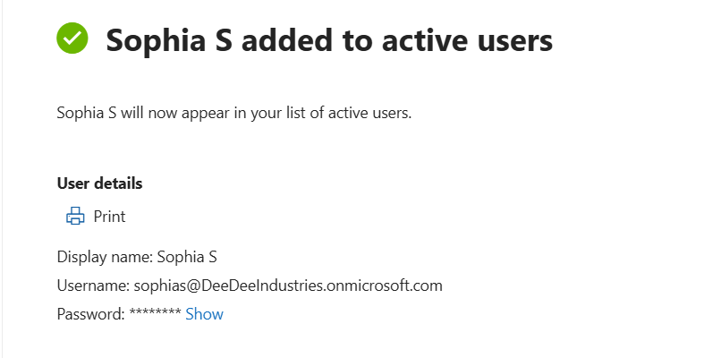
# Active User Management

**Reviewed and managed user accounts through the Active Users dashboard.**

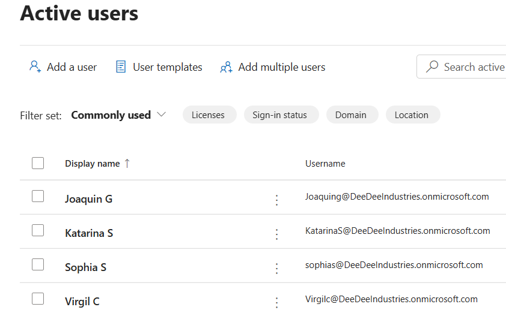
## Password Management

**Performed a password reset on user account Sophia S for simulation.**

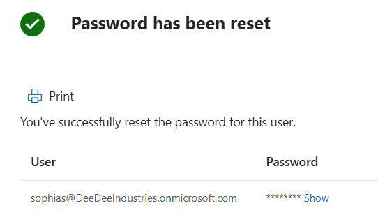
## Microsoft Entra ID Administration

**Reviewed and managed user accounts through Microsoft Entra ID.**

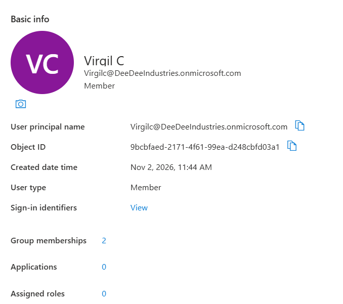
## User Block Sign-In

**Blocked user account Virgil C sign-in to simulate the employee offboarding process.**

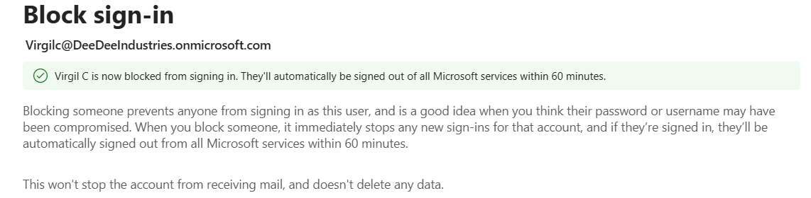
# Group Administration 
## Group Creation & Membership

**Created Microsoft 365 group and managed users within group membership.**

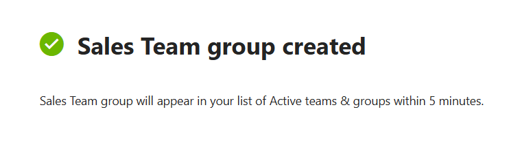
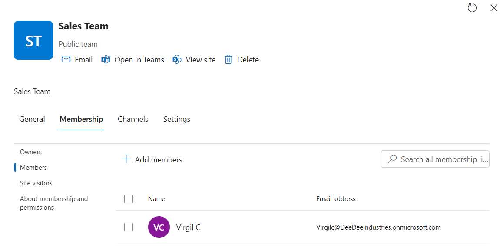
# Role-Based Access Control
## Role Assignment

**Assigned administrative permissions to user account Sophia S using Microsoft Entra ID role assignments.**

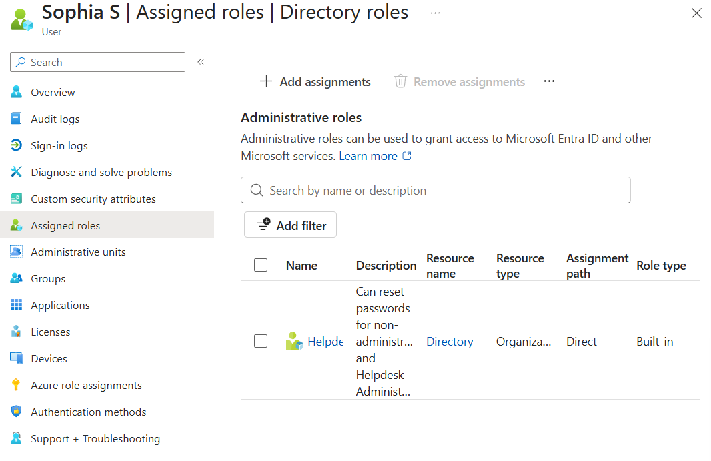
# Shared Mailbox Management
## Shared Mailbox Creation

**Created and configured a shared mailbox for the "Help Desk" department.**

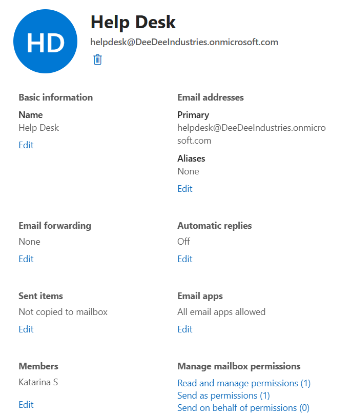
# Authentication & Security
## Multi-Factor Authentication(MFA)

**Enabled MFA on user account Sophia S to improve security.**

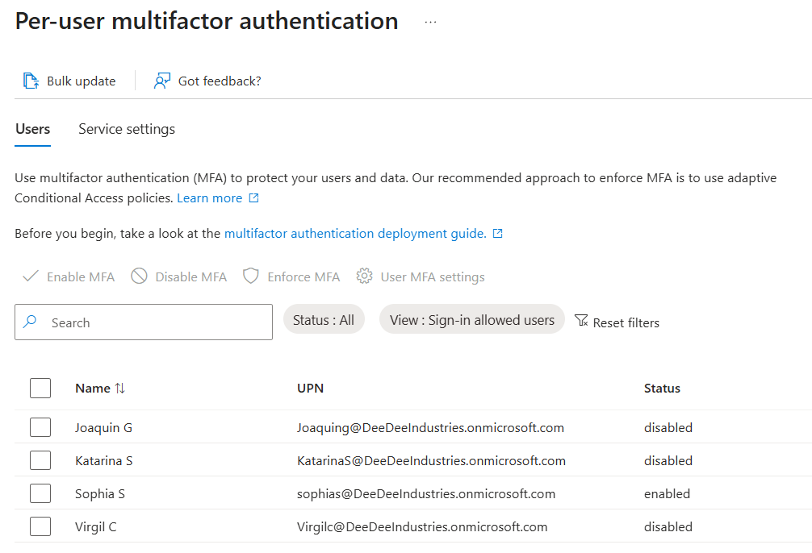
# Auditing & Monitoring
## Audit Log Review

**Reviewed administrative activity using Microsoft Entra audit logs. Confirmed activity showed user creation, password resets, and group changes.**

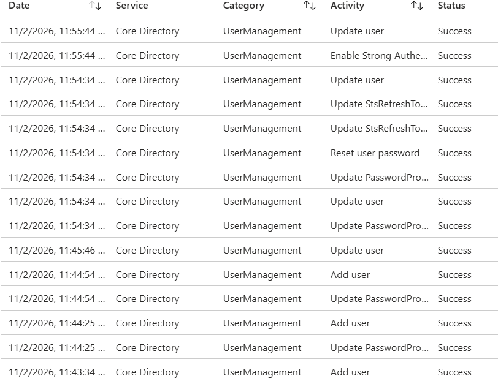

# Skills Demonstrated 
-Microsoft 365 Administration
-Microsoft Entra ID
-Identity & Access Management (IAM) 
-User Administration
-Password Management
-Multi-Factor Authentication (MFA)
-Microsoft 365 Group Administration
-Role-Based Access Control (RBAC)
-Shared Mailbox Configuration
-Audit Log Monitoring

# Tools Used
-Microsoft 365 Admin Center
-Microsoft Entra ID
-Exchange Admin Center
-Microsoft Authenticator

# Outcome 
Successfully administered a Microsoft 365 environment using the Admin center and Entra ID. This lab shows basic help desk tasks including user provisioning, password resets, group management, MFA configuration, RBAC administration, and audit reviews. 
